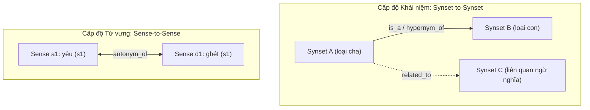

# Đặc tả Profile WordNet Cảm xúc Tiếng Việt (G2a)

**Dự án:** Emotionet  
**Phiên bản:** 1.0 — Ngày 24/11/2026  
**Cơ sở kế thừa:** [Biên bản tiếp nhận G2](review-receipt-2026-11-24.md) và [Kế hoạch WordNet v2.0](../Ke_hoach_WordNet_cam_xuc_tieng_Viet.md).

Tài liệu này xác lập quy chuẩn biên soạn từ loại (POS), cấu trúc quan hệ hai cấp (synset-level và sense-level), các ràng buộc phân cấp và giải pháp kỹ thuật cho các nhóm từ đa nghĩa trong WordNet cảm xúc tiếng Việt.

---

## 1. Hệ thống Từ loại (Part of Speech - POS)

Biểu thức cảm xúc tiếng Việt được chuẩn hóa thành 4 nhóm từ loại chính:

| POS Code | Tên từ loại | Định nghĩa trong miền cảm xúc | Ví dụ minh họa |
|---|---|---|---|
| `a` / `adj` | **Tính từ tâm lý / trạng thái** | Trạng thái cảm xúc nội tâm, mức độ rung cảm hoặc tính chất gây cảm xúc của sự vật | *vui, buồn, nhẹ nhõm, bực mình, lo lắng, hào hứng, hài hước, đau đớn* |
| `v` / `verb` | **Động từ cảm xúc / tâm lý** | (1) Psych-verbs: trải nghiệm hoặc hướng tình cảm/thái độ đến đối tượng; (2) Expressive verbs: hành vi phát ngôn hoặc biểu lộ cảm xúc | (1) *yêu, thương, ghét, giận, khâm phục, quan tâm, lo lắng cho*; (2) *cám ơn, tán thành, vỡ lẽ, ăn năn, hờn dỗi* |
| `n` / `noun` | **Danh từ cảm xúc / thực thể** | Tên gọi của cảm xúc, trạng thái tinh thần hoặc sự vật, hành vi, tác nhân làm nảy sinh cảm xúc | *nỗi buồn, niềm vui, sự hối hận, trò đùa, thú vui, tội ác, bi kịch* |
| `r` / `adv` | **Phó từ / Định ngữ thể hiện** | Từ bổ nghĩa chỉ phương thức, thời điểm bộc phát hoặc cường độ của trạng thái tâm lý | *chợt, thoáng, bỗng, rất, cực kỳ, lắm* |

### Quy tắc xử lý hiện tượng kiêm tính (Dual-category):
- Tiếng Việt có nhiều từ vừa dùng như vị từ vị ngữ (tính từ/động từ) vừa có thể làm trung tâm ngữ của cụm danh từ mà không biến đổi hình thái (*nỗi lo*, *sự giận dữ*, *niềm vui*).
- **Quy tắc phân định:** Căn cứ vào chức năng cú pháp và ngữ nghĩa nguyên bản của sense đang xét:
  - Nếu từ biểu đạt trạng thái nội tâm trực tiếp $\rightarrow$ Gán `adj` (ví dụ: *rất vui*, *buồn quá*).
  - Nếu từ có đối tượng tác động (experiencer $\rightarrow$ stimulus / target) $\rightarrow$ Gán `verb` (ví dụ: *yêu mẹ*, *ghét kẻ dối trá*).
  - Nếu từ kết hợp với lượng từ/danh từ chỉ loại (*niềm*, *nỗi*, *sự*) $\rightarrow$ Tách sense danh từ hóa (`noun`) riêng biệt khi mở rộng concept.

---

## 2. Kiến trúc Quan hệ Hai cấp (Two-level Relations)

Kế thừa mô hình WordNet chuẩn quốc tế (WN-LMF), Emotionet phân tách rành mạch quan hệ ở cấp độ **Khái niệm (Synset-to-Synset)** và cấp độ **Từ vựng (Sense-to-Sense)**:

### 2.1. Quan hệ cấp Khái niệm (Synset-to-Synset)

1. **Quan hệ phân cấp (`is_a` / `hypernym_of` / `hyponym_of`):**
   - **Ràng buộc POS bắt buộc:** Chỉ được phép nối giữa hai synset **cùng từ loại** (`adj` $\rightarrow$ `adj`, `verb` $\rightarrow$ `verb`, `noun` $\rightarrow$ `noun`). Không cho phép phân cấp chéo từ loại (ví dụ: không nối tính từ *hài hước* vào danh từ *trò đùa*).
   - **Tiêu chuẩn 5 bước G2:**
     - Bao hàm một chiều nghiêm ngặt (Forward entailment = `yes`, Reverse entailment = `no`).
     - Có đặc điểm phân biệt nghĩa hẹp (`differentia`) rõ ràng.
     - Khác biệt thuần túy về cường độ (intensity: *khao khát* vs *mong muốn*, *kinh ngạc* vs *bất ngờ*) hoặc sắc thái văn phong (*sầu* vs *buồn*) **không được tạo cạnh `is_a`**.
     - Áp dụng thỏa mãn cho toàn bộ member senses của synset, không chỉ lemma đại diện.
   - **Chống chu trình (Cycle Prevention):** Đồ thị `is_a` phải là đồ thị có hướng không chu trình (DAG).

2. **Quan hệ liên quan ngữ nghĩa (`related_to`):**
   - Dùng cho các liên tưởng ngữ nghĩa gần gũi giữa các khái niệm cảm xúc, hoặc giữa cảm xúc và tác nhân/hoàn cảnh/tính cách.
   - **Cho phép liên kết chéo từ loại (Cross-POS):**
     - Cảm xúc (`adj`) $\leftrightarrow$ Tính cách (`adj`): *buồn cười* $\leftrightarrow$ *vui tính*.
     - Cảm xúc (`adj`) $\leftrightarrow$ Tác nhân / Hành vi (`noun`): *hài hước* $\leftrightarrow$ *trò đùa*.
     - Cảm xúc (`adj`) $\leftrightarrow$ Hoàn cảnh (`verb`/`noun`): *buồn* $\leftrightarrow$ *thất tình*.
     - Nhận thức (`verb`) $\leftrightarrow$ Phó từ khoảnh khắc (`adv`): *nhận ra* $\leftrightarrow$ *chợt*.

### 2.2. Quan hệ cấp Từ vựng (Sense-to-Sense)

1. **Quan hệ trái nghĩa (`antonym_of`):**
   - Trái nghĩa từ vựng chặt chẽ vốn là quan hệ giữa các từ/nghĩa cụ thể (ví dụ: *yêu* đối nghịch trực tiếp với *ghét*, *vui* đối nghịch trực tiếp với *buồn*).
   - **Ràng buộc:** Bắt buộc cùng phạm trù từ loại và cấu trúc nghĩa.
   - Các cặp đối lập về cực tính cảm xúc tổng quát (valence: *buồn cười* vs *tủi thân*) hoặc đối lập giữa trạng thái tâm lý và chuẩn mực nhận thức (*hối hận* vs *đúng đắn*) không thỏa mãn `antonym_of` nhị phân, phải chuyển về `related_to` ở cấp synset.

---

## 3. Xử lý các Ca Đặc thù và Điều chỉnh Membership G2

Kế thừa các quyết định đã chốt trong [review-receipt-2026-11-24.md](review-receipt-2026-11-24.md):

### 3.1. Nhóm `khâm phục / nể / phục` (`syn_770c2e9f56867e77`)
- **Vấn đề:** Từ `nể` trong tiếng Việt đa nghĩa:
  - `nể_s1` (nể phục): Khâm phục tài năng, đức độ của người khác $\rightarrow$ Thuộc miền `admiration`.
  - `nể_s2` (kiêng nể, nể nang): E dè, ngại làm mất lòng hoặc vì quan hệ xã giao $\rightarrow$ Không thuộc `admiration`.
- **Giải pháp:**
  - Giữ `nể_s1` trong synset `khâm phục; nể; phục` với điều kiện ngữ cảnh chặt chẽ.
  - Tách `nể_s2` thành sense độc lập (`pos: v`, gloss: *"Kiêng dè, tránh làm mất lòng người khác vì nể nang"*), không đưa vào nhãn `admiration`.

### 3.2. Nhóm `buồn / đau lòng / tủi thân` (`syn_bfcacfd3e7930678`)
- **Vấn đề:** `tủi thân` mang nét nghĩa rất đặc thù: tự thương xót, buồn tủi cho số phận đơn độc, thiệt thòi của chính mình; không thể hoán đổi đồng nghĩa với `buồn` chung.
- **Giải pháp:**
  - Điều chỉnh `membership_decision = revise`: Loại `sense_cand_d6b678c30a79` (`tủi thân`) khỏi synset `syn_bfcacfd3e7930678`.
  - Synset gốc giữ 2 thành viên: `buồn` và `đau lòng` (`definition`: *"Trạng thái tâm lý u sầu, đau lòng, ủ rũ khi gặp điều trắc trở"*).
  - Khởi tạo concept riêng cho `tủi thân` (`syn_tui_than`):
    - `preferred_lemma`: tủi thân
    - `pos`: `adj`
    - `definition`: *"Nỗi buồn tủi, xót xa cho thân phận đơn độc và chịu nhiều thiệt thòi của chính mình"*
    - `emotion_labels`: `sadness`
    - `relation`: `syn_tui_than` liên kết `related_to` (hoặc `hyponym_of`) với `syn_bfcacfd3e7930678`.

### 3.3. Nhóm `biết ơn / cám ơn` (`syn_1560f3c8e023185b`)
- **Giải pháp:** Giữ chung synset với chú thích phân biệt: `biết ơn` là tâm trạng rung cảm nội tâm (`pos: v/adj`), `cám ơn` là hành vi phát ngôn xã giao (`pos: v`). Định nghĩa synset bao quát: *"Lòng ghi nhớ, cảm kích sự giúp đỡ của người khác và lời biểu lộ sự cảm kích đó"*.

### 3.4. Nhóm `hối hận / tiếc nuối / day dứt / hối tiếc` (`syn_52309529a62e915d`)
- **Giải pháp:** Giữ chung trong miền `remorse` với lưu ý phân biệt: `hối hận / day dứt / hối tiếc` gắn liền với ý thức tự trách vì lỗi lầm quá khứ; `tiếc nuối` có thể do hoàn cảnh khách quan lỡ mất cơ hội. Khi thiết lập cạnh cha cho `ăn năn`, quan hệ `is_a` hướng thẳng vào nét nghĩa tự trách sai lầm của synset này.

---

## 4. Bảng Kết quả Phân giải 29 Quan hệ Nguồn

Đã thẩm định, phân giải nghĩa đích và gán định nghĩa chuẩn hóa cho toàn bộ 29 dòng trong [relation-review.csv](../../data/local/g2-review-reconciled-v1/relation-review.csv):

| STT | Review ID | Synset Nguồn (POS) | Predicate | Từ đích | POS Đích | Nghĩa chuẩn hóa đề xuất của từ đích (`proposed_object_definition`) | Quyết định | Ghi chú ngữ nghĩa |
|:---:|---|---|:---:|---|:---:|---|:---:|---|
| 1 | `g2_rel_3c2babb98830` | buồn cười (`a`) | `related_to` | tủi thân | `a` | Nỗi buồn tủi cho thân phận đơn độc, thiệt thòi của chính mình | **`revise`** | Trỏ đến synset tủi thân đã tách; chuyển thành related_to do tương phản cực tính cảm xúc, không phải trái nghĩa từ vựng nhị phân |
| 2 | `g2_rel_a1b35ccd3193` | buồn cười (`a`) | `related_to` | vui tính | `a` | Tính cách cởi mở, hay cười đùa và dễ mang lại niềm vui cho người khác | **`accept`** | Liên quan giữa tính cách và cảm xúc khôi hài |
| 3 | `g2_rel_3e60dcb8d94d` | hài hước (`a`) | `related_to` | trò đùa | `n` | Hành vi hoặc lời nói bông đùa nhằm gây cười, trêu vui | **`accept`** | Tác nhân/hành vi gây cười gắn với tính chất hài hước |
| 4 | `g2_rel_da4e354c7e37` | hài hước (`a`) | `related_to` | thú vui | `n` | Hoạt động hoặc sở thích đem lại sự thư giãn, hào hứng cho tinh thần | **`accept`** | Hoạt động giải trí tạo cảm xúc vui thích |
| 5 | `g2_rel_3c3a043d1b94` | vui (`a`) | `related_to` | vô tư | `a` | Thanh thản, không bận tâm lo nghĩ hay vướng bận toan tính | **`accept`** | Trạng thái tâm lý không vướng bận là nền tảng niềm vui |
| 6 | `g2_rel_90ac7fd56adc` | vui (`a`) | `related_to` | cởi mở | `a` | Thái độ hòa nhã, sẵn lòng chia sẻ và đón nhận người khác | **`accept`** | Thái độ chan hòa thường song hành với tâm trạng vui |
| 7 | `g2_rel_984f1f6df244` | hạnh phúc (`a`) | `related_to` | bình an | `a` | Yên ổn, thanh thản, không gặp điều trắc trở hay mối lo sợ | **`accept`** | Sự an yên nội tâm là cốt lõi của hạnh phúc |
| 8 | `g2_rel_24bb01e7425a` | hạnh phúc (`a`) | `related_to` | ấm áp | `a` | Cảm giác dễ chịu, chan chứa tình yêu thương và sự sẻ chia | **`accept`** | Sắc thái cảm xúc dễ chịu đi liền với hạnh phúc |
| 9 | `g2_rel_7e6b6ca2fa47` | yêu thương (`v/a`) | `antonym_of` | ích kỷ | `a` | Chỉ biết vì lợi ích cá nhân của mình mà không màng đến người khác | **`accept`** | Đối lập định hướng thái độ: vị tha đùm bọc vs vị kỷ chỉ vì mình |
| 10 | `g2_rel_b52ad8b5d288` | yêu;thương (`v`) | `related_to` | đau xót | `a` | Cảm giác đau đớn, xót xa sâu sắc trước nỗi đau của người khác | **`accept`** | Cảm xúc nảy sinh khi đối tượng yêu thương gặp hoạn nạn |
| 11 | `g2_rel_bbc7b6e36c74` | yêu;thương (`v`) | `related_to` | xót xa | `a` | Xót thương, đau lòng một cách thấm thía trước cảnh ngộ éo le | **`accept`** | Biểu hiện tình cảm xót thương trong miền caring/sadness |
| 12 | `g2_rel_0b7cc1161a8f` | yêu;thương (`v`) | `antonym_of` | ác độc | `a` | Có dã tâm hiểm ác, tàn nhẫn và sẵn sàng gây đau khổ cho người khác | **`accept`** | Lòng yêu thương đùm bọc đối nghịch với dã tâm độc ác |
| 13 | `g2_rel_d67b2d7ac3a2` | yêu;thương (`v`) | `related_to` | tội nghiệp | `a` | Gợi cảm giác thương hại, xót xa vì chịu nhiều thiệt thòi, bất hạnh | **`accept`** | Đối tượng khơi gợi lòng trắc ẩn, yêu thương |
| 14 | `g2_rel_d74dde98d8a0` | thương (`v`) | `related_to` | đau xót | `a` | Cảm giác đau đớn, xót xa sâu sắc trước nỗi đau của người khác | **`accept`** | Liên quan trực tiếp giữa thương và đau xót |
| 15 | `g2_rel_9d327117f2c6` | thương (`v`) | `antonym_of` | ác độc | `a` | Có dã tâm hiểm ác, tàn nhẫn và sẵn sàng gây đau khổ cho người khác | **`accept`** | Đối lập giữa tình cảm xót thương và tâm địa tàn nhẫn |
| 16 | `g2_rel_bc8f37dbc4dd` | thương (`v`) | `related_to` | xót xa | `a` | Xót thương, đau lòng một cách thấm thía trước cảnh ngộ éo le | **`accept`** | Biểu hiện cảm xúc của lòng xót thương |
| 17 | `g2_rel_6acd1c9ec41d` | thương (`v`) | `related_to` | tội nghiệp | `a` | Gợi cảm giác thương hại, xót xa vì chịu nhiều thiệt thòi, bất hạnh | **`accept`** | Tính chất tội nghiệp là đối tượng kích hoạt tình thương |
| 18 | `g2_rel_74e576f6ebd7` | thương (`v`) | `related_to` | mến | `v` | Có thiện cảm và lòng quý trọng, muốn gần gũi với ai đó | **`accept`** | Cận đồng nghĩa trong miền cảm xúc yêu mến (love/caring) |
| 19 | `g2_rel_ebb4558baa2d` | ngưỡng mộ (`v`) | `related_to` | đồng cảm | `v` | Hiểu thấu và cùng chia sẻ cảm xúc, rung động với người khác | **`accept`** | Đồng cảm tâm hồn thường thúc đẩy lòng ngưỡng mộ |
| 20 | `g2_rel_252d726c52be` | ngưỡng mộ (`v`) | `related_to` | tinh tế | `a` | Nhạy cảm, khéo léo và sâu sắc trong nhận thức hoặc ứng xử | **`accept`** | Phẩm chất tinh tế là đối tượng khơi gợi sự ngưỡng mộ |
| 21 | `g2_rel_c5182ff2223d` | khâm phục (`v`) | `related_to` | nhân ái | `a` | Có tình cảm thương yêu, bao dung và sẵn lòng giúp đỡ đồng loại | **`accept`** | Đức tính nhân ái là đối tượng cao đẹp khơi dậy sự khâm phục |
| 22 | `g2_rel_aabcd8e17c29` | khâm phục (`v`) | `related_to` | dũng cảm | `a` | Dám đối đầu với hiểm nguy, khó khăn mà không hề sợ hãi | **`accept`** | Sự dũng cảm là nguyên nhân làm nảy sinh lòng nể phục |
| 23 | `g2_rel_97662ea5a444` | nhận ra; vỡ lẽ (`v`) | `related_to` | chợt | `r` | Bất ngờ, đột ngột xảy đến trong khoảnh khắc ngắn ngủi | **`accept`** | Phó từ chỉ khoảnh khắc bất ngờ kết hợp chặt chẽ với nhận thức |
| 24 | `g2_rel_57778d4e09d1` | hoang mang (`a`) | `related_to` | mông lung | `a` | Mơ hồ, mờ mịt và không có điểm tựa xác định | **`accept`** | Sự mơ hồ mông lung là nguồn cơn gây hoang mang (confusion) |
| 25 | `g2_rel_802c1ae09c80` | hối hận (`v/a`) | `related_to` | đúng đắn | `a` | Phù hợp với chuẩn mực, sự thật và lẽ phải, không phạm sai lầm | **`revise`** | Lệch phạm trù từ loại và cảm xúc (hối hận là tâm lý tự trách, đúng đắn là nhận thức chuẩn mực); chuyển thành related_to |
| 26 | `g2_rel_d280b57a1b21` | buồn; đau lòng (`a`) | `related_to` | thất tình | `v/a` | Rơi vào cảnh bị từ chối hoặc tan vỡ trong tình cảm lứa đôi | **`accept`** | Hoàn cảnh tan vỡ tình cảm gây nên nỗi buồn đau lòng |
| 27 | `g2_rel_b7dfde146644` | ghét (khinh ghét) (`v`) | `related_to` | khinh | `v` | Coi thường, đánh giá thấp và không tôn trọng đối tượng | **`accept`** | Thái độ khinh miệt gắn liền với cảm xúc khinh ghét (disgust) |
| 28 | `g2_rel_a5c88362a580` | ghét (căm ghét) (`v`) | `related_to` | khinh | `v` | Coi thường, đánh giá thấp và không tôn trọng đối tượng | **`accept`** | Thái độ khinh rẻ thường song hành với căm ghét |
| 29 | `g2_rel_bab4d75a6bdf` | giận (`v/a`) | `related_to` | dỗi | `v/a` | Tỏ thái độ giận hờn, làm mình làm mẩy để biểu lộ sự không bằng lòng nhẹ | **`accept`** | Hành vi hờn dỗi là biểu hiện mức độ nhẹ của cảm xúc giận |

---

## 5. Kết luận và Hướng triển khai tiếp theo

1. **Về dữ liệu:** Toàn bộ 29 quan hệ đã được hoàn thiện trong phiếu [relation-review.csv](../../data/local/g2-review-reconciled-v1/relation-review.csv) với đầy đủ định nghĩa đề xuất cho 28 concept đích mới, sẵn sàng cho việc cấp ID và mở rộng đồ thị trong giai đoạn G2c.
2. **Về quy chuẩn:** Quy tắc WordNet và ràng buộc POS trong tài liệu này đảm bảo việc xây dựng đồ thị quan hệ phân cấp (`is_a`) và đối lập (`antonym_of`) hoàn toàn tuân thủ các chuẩn mực ngôn ngữ học WordNet quốc tế, tránh các lỗi sai lệch từ loại và phân cấp khiên cưỡng.
3. **Về hệ thống:** Đảm bảo toàn bộ 74/74 unit tests tiếp tục vượt qua ổn định.
